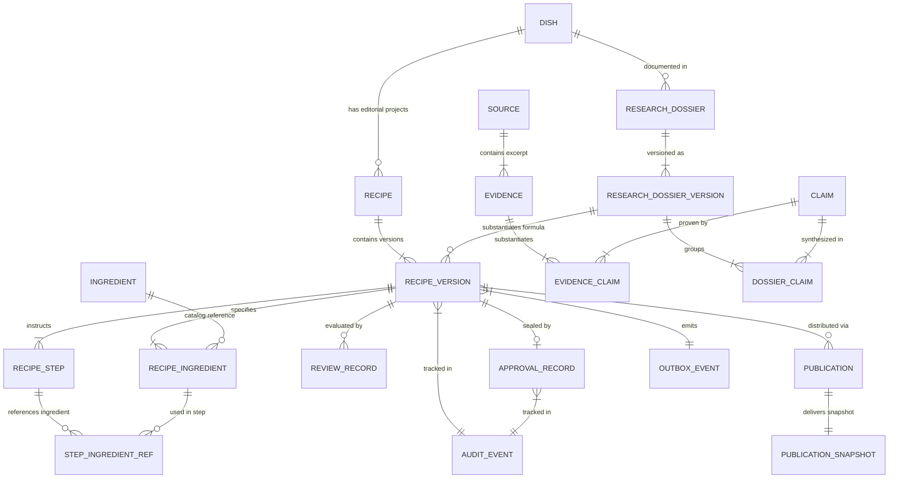

# ATLAS GASTRONOMIC — DOMAIN MODEL & ENTITY RELATIONSHIPS

**Document:** Modelul de Domeniu, Ontologia și Constrângerile Relaționale  
**Etapă:** PHASE 2.1 — Architecture Reconciliation  
**Guvernanță:** Atlas AOS  
**Data:** 2026-10-13  
**Statut:** Propunere Arhitecturală Formală  

---

## 1. Diagrama Modelului de Domeniu (ERD)



---

## 2. Entitățile de Bază și Responsabilitățile Lor

### 2.1 Ierarhia Culinară (3 Niveluri)
1. **`Dish` (Preparatul Canonic):** Identitatea culturală, denumirea canonică și tradiția culinară (ex: *„Sarmale în foi de varză”*). Nu conține gramaje sau timpi de gătire implacabili. Agregă dosarele de cercetare.
2. **`Recipe` (Proiectul Editorial):** O abordare editorială specifică a preparatului (ex: *„Sarmale moldovenești de Crăciun — Rețeta de referință Atlas”*). Deține autorul, scopul editorial și agregă versiunile sale SemVer.
3. **`RecipeVersion` (Formula Tehnică):** Starea exactă, testabilă și reproductibilă la un număr SemVer (`version_number`: `1.0.0`). Conține gramajele exacte, timpii, temperaturile și instrucțiunile ordonate. Odată aprobată, conținutul devine **read-only**.

### 2.2 Modelul de Cercetare Epistemologică
4. **`Source`:** Documentul bibliografic sau resursa web (titlu, autor, editor, ediție, an, URL/ISBN).
5. **`Evidence`:** Extrasul textual concret, citatul verificat, pagina și capitolul extras din `Source`.
6. **`Claim`:** Propoziția declarativă gastronomică, clasificată după gradul de certitudine (`documented`, `widely_attested`, `editorial_interpretation`, `uncertain`).
7. **`ResearchDossier` & `ResearchDossierVersion`:** Dosarul sintetic care grupează afirmațiile, probele și contradicțiile documentate pentru un `Dish`. `RecipeVersion` referă obligatoriu o versiune specifică aprobată a dosarului (`research_dossier_version_id`).

### 2.3 Ingrediente și Pași Procedurali
8. **`Ingredient`:** Entitatea normalizată din catalogul canonic (nume canonic, denumire în română, categorie, alergeni cunoscuți).
9. **`RecipeIngredient`:** Utilizarea unui ingredient într-o versiune specifică: cantitate numerică, unitate explicită, stare fizică (ex: tocat fin, fiert și scurs), grup de preparare și bifa `is_garnish_or_serving`.
10. **`RecipeStep`:** Pas secvențial ordonat: instrucțiune detaliată, durată, temperatură, nivel de căldură și criteriu observabil de succes (`success_cue`).
11. **`StepIngredientRef`:** Legătura structurală joncțiune între pas și ingredientele consumate în acel pas.

### 2.4 Aprobare, Publicare și Audit
12. **`ReviewRecord`:** Înregistrarea formală a evaluării tehnice culinare sau lingvistice, conținând scorurile, comentariile, versiunea rubricii și hash-ul conținutului evaluat.
13. **`ApprovalRecord`:** Actul juridic de certificare umană (1:1 cu `RecipeVersion`). Conține identitatea aprobatatorului, data, hash-ul conținutului aprobat și semnătura.
14. **`Publication`:** Înregistrarea de distribuție pe canale (1:N cu `RecipeVersion`).
15. **`PublicationSnapshot`:** Documentul JSON denormalizat, imuabil, servit consumatorilor publici.
16. **`AuditEvent` & `OutboxEvent`:** Jurnalul append-only al tuturor acțiunilor și coada de tranzacții asincrone.

---

## 3. Constrângerea Relațională PostgreSQL pentru `StepIngredientRef`

Pentru a garanta la nivelul schemei relaționale (și nu doar prin validatoare Zod la nivel de aplicație) că un pas și un ingredient referit aparțin **aceleiași versiuni de rețetă**, modelul utilizează **Chei Străine Compuse (Composite Foreign Keys)**:

```sql
-- Constrângeri de unicitate pe versiune în tabelele copil
ALTER TABLE recipe_steps 
  ADD CONSTRAINT uq_step_version UNIQUE (recipe_version_id, id);

ALTER TABLE recipe_ingredients 
  ADD CONSTRAINT uq_ingredient_version UNIQUE (recipe_version_id, id);

-- Tabela joncțiune forțează același recipe_version_id
CREATE TABLE step_ingredient_refs (
    recipe_version_id UUID NOT NULL,
    step_id UUID NOT NULL,
    recipe_ingredient_id UUID NOT NULL,
    created_at TIMESTAMPTZ NOT NULL DEFAULT now(),
    
    PRIMARY KEY (step_id, recipe_ingredient_id),
    
    CONSTRAINT fk_ref_to_step 
      FOREIGN KEY (recipe_version_id, step_id) 
      REFERENCES recipe_steps(recipe_version_id, id) 
      ON DELETE RESTRICT,
      
    CONSTRAINT fk_ref_to_ingredient 
      FOREIGN KEY (recipe_version_id, recipe_ingredient_id) 
      REFERENCES recipe_ingredients(recipe_version_id, id) 
      ON DELETE RESTRICT
);
```

*Garanție Matematică:* PostgreSQL refuză fizic orice inserare în `step_ingredient_refs` dacă `recipe_version_id`-ul pasului nu este identic cu `recipe_version_id`-ul ingredientului.

---

## 4. Protocolul de Blocare și Verificare a Imutabilității Complete

### 4.1 Problema Concurenței și a Tranzacțiilor Hibride
Compararea coloanelor vechi și noi (`OLD` vs `NEW`) din tabela `recipe_versions` este insuficientă pentru a preveni modificarea neautorizată a ingredientelor sau pașilor în aceeași tranzacție care promovează statusul la `human_approved`. În plus, o tranzacție concurentă ar putea insera sau modifica un ingredient într-un copil în timp ce părintele este în curs de aprobare.

### 4.2 Protocolul de Blocare la Nivel de Părinte și Protecția Copiilor (Parent Row Locking)
Pentru a elimina complet race condition-urile la nivel relațional:

1. **Protocolul de Mutație pe Tabelele Copil (Insert / Update / Delete):**
   Orice tranzacție care modifică entitățile copil asociate unei versiuni (`recipe_ingredients`, `recipe_steps`, `cultural_context`, `step_ingredient_refs`) este obligată arhitectural să obțină un lock partajat pe versiunea părinte **înainte** de a efectua orice modificare asupra tabelelor copil:
   ```sql
   SELECT id, status FROM recipe_versions WHERE id = :version_id FOR SHARE;
   ```
   Dacă `status IN ('human_approved', 'published', 'archived')`, tranzacția este respinsă instantaneu la nivel de aplicație.

2. **Protecția Tranzacțională Obligatorie la Nivel de Bază de Date (`BEFORE INSERT OR UPDATE OR DELETE`):**
   Pentru a preveni orice ocolire a protocolului de aplicație (de exemplu prin scripturi directe sau procese paralele), baza de date impune triggeri de verificare la nivel relațional pe toate tabelele copil protejate:
   - `recipe_ingredients`
   - `recipe_steps`
   - `cultural_context`
   - `step_ingredient_refs`
   
   Fiecare operațiune (`BEFORE INSERT`, `BEFORE UPDATE`, `BEFORE DELETE`) pe aceste tabele declanșează o verificare directă a statusului versiunii părinte (`recipe_versions`). Dacă părintele are `status IN ('human_approved', 'published', 'archived')`, operațiunea declanșează un `EXCEPTION` tranzacțional și execută `ROLLBACK`. Astfel, inserarea de noi copii (`INSERT`) este la fel de strict blocată precum actualizarea (`UPDATE`) sau ștergerea (`DELETE`).

3. **Separarea Tranzițiilor de Status de Conținutul Gastronomic:**
   Pe tabela părinte `recipe_versions`, triggerul de imutabilitate distinge strict între:
   - *Tranzițiile autorizate de ciclu de viață:* Coloana `status` poate fi actualizată exclusiv conform mașinii canonice de stări (ex: din `editorial_review` în `human_approved`) de către actori autorizați RBAC.
   - *Imutabilitatea conținutului gastronomic:* Toate coloanele gastronomice (`servings`, `prep_time_minutes`, `cook_time_minutes`, `difficulty_level`, `canonical_title`, `research_dossier_version_id`) sunt strict înghețate; orice tentativă de a modifica conținutul simultan cu aprobarea sau post-aprobare este respinsă tranzacțional (`NEW.col == OLD.col`).

4. **Procedura de Aprobare Umană (Lock Exclusiv):**
   Comanda de aprobare editorială obține un lock exclusiv asupra părintelui la începutul tranzacției:
   ```sql
   SELECT id, status FROM recipe_versions WHERE id = :version_id FOR UPDATE;
   ```
   Conform matricii de compatibilitate PostgreSQL, `FOR UPDATE` este incompatibil cu `FOR SHARE`. Astfel:
   - Orice tentativă concurentă de mutație pe copii (care cere `FOR SHARE`) va fi blocată până la finalizarea tranzacției de aprobare.
   - După ce tranzacția de aprobare face commit (stabilind `status = 'human_approved'`), tranzacția copil deblocată va constata statusul aprobat și va fi respinsă de triggerul `BEFORE INSERT/UPDATE/DELETE`.

### 4.3 Verificarea Deterministică prin Hash Canonic (SHA-256) și Specificația de Serializare

Pentru a asigura că versiunea aprobată este matematic identică cu cea inspectată de recenzori, sistemul utilizează un algoritm strict de calcul al hash-ului canonic.

1. **Baza de Serializare Canonică (Propunere: RFC 8785 — JCS):**
   Se propune utilizarea standardului **RFC 8785 (JSON Canonicalization Scheme - JCS)** pentru serializarea deterministă a structurii JSON (sortarea cheilor obiectelor, eliminarea spațiilor albe nesemnificative, formatarea strictă a delimitatorilor).
   *Notă critică:* RFC 8785 rezolvă exclusiv formatarea sintactică a JSON-ului, dar **nu rezolvă de la sine normalizarea Unicode, valorile zecimale sau semantica de domeniu**. Acestea sunt definite explicit mai jos.

2. **Reguli de Normalizare a Domeniului:**
   - **Normalizare Unicode:** Toate șirurile textuale (titluri, instrucțiuni, note culturale, nume de ingrediente) sunt normalizate obligatoriu la forma **Unicode NFC (Normalization Form C)** înainte de serializare. Această regulă este critică pentru limba română pentru a preveni divergențele între caracterele cu virgulă dedesubt (ex: `ș` `U+0219`, `ț` `U+021B`) și caracterele incorecte cu sedilă (`ş` `U+015F`, `ţ` `U+0163`).
   - **Reprezentarea Valorilor Zecimale:** Cantitățile numerice sunt serializate ca șiruri exacte de tip zecimal cu punct fix (ex: `"1.500"` sau string canonic fără zero-uri finale redundante determinat de o schemă strictă de tip `Decimal(10,3)`), eliminând complet aproximările și ambiguitățile reprezentării IEEE 754 în virgulă mobilă (`float`).
   - **Vocabular Controlat pentru Unități de Măsură:** Unitățile de măsură nu sunt normalizate prin simple conversii de majuscule/minuscule la runtime, ci sunt mapate strict la cheia canonică din vocabularul controlat al modulului de Taxonomie (ex: `GRAM`, `MILLILITER`, `PIECE`).
   - **Semantica Valorilor Nule și Omise:** În schema de serializare, se distinge strict între valoarea `null` (câmp aplicabil dar nespecificat), absența câmpului (omisiune) și șirul vid `""`. Câmpurile opționale care nu conțin date sunt omise determinist sau serializate conform definiției stricte din schema versiunii, fără echivalări silențioase între concepte diferite gastronomic.
   - **Sortarea Deterministică a Entităților Copil:**
     * `RecipeIngredient`: sortate determinist după cheia compusă `(sequence_order ASC, canonical_ingredient_id ASC, id ASC)`.
     * `RecipeStep`: sortate determinist după `(step_number ASC, id ASC)`.
     * `StepIngredientRef`: sortate determinist după `(step_id ASC, recipe_ingredient_id ASC)`.
     * `CulturalContext`: ordonare canonică a cheilor de secțiune.

3. **Formatul de Versiune al Hash-ului:**
   Rezultatul criptografic este calculat cu SHA-256 și stocat într-un format explicit versionat:
   $$\text{canonical\_hash} = \text{"v1:sha256:"} + \text{HexDigest}(\text{SHA-256}(\text{JCS\_Payload}))$$
   Identificatorul de schemă/versiune (`v1`) asigură că istoricul rețetelor rămâne verificabil în viitor chiar dacă se adoptă algoritmi sau scheme de serializare actualizate.

4. **Verificarea în Tranzacția de Aprobare:**
   În cadrul tranzacției de aprobare, comanda recalculează:
   $$\text{current\_content\_hash} == \text{review\_records.evaluated\_content\_hash}$$
   Dacă hash-ul calculat pe starea curentă a bazei de date diferă de cel semnat de recenzorul editorial la finalizarea evaluării, tranzacția execută **`ROLLBACK` imediat**. La succes, hash-ul este salvat imuabil în `approval_records.content_hash`.

---

## 5. Delimitarea Arhitecturală a Retenției Datelor și Protecția Intimității (GDPR)

### 5.1 Distincția Legală între Pseudonimizare și Anonimizare
* **Statutul Datelor Personale conform GDPR (Art. 4(5)):**
  - **Pseudonimizarea** reprezintă prelucrarea datelor cu caracter personal astfel încât acestea să nu mai poată fi atribuite unei persoane vizate fără utilizarea unor informații suplimentare. Atâta timp cât un identificator (cum ar fi un UUID persistent) permite corelarea cu alte înregistrări sau chei interne, datele **rămân date cu caracter personal** în sensul legii.
  - **Anonimizarea** implică eliminarea ireversibilă a oricărei posibilități rezonabile de identificare directă sau indirectă.
* **Delimitare Arhitecturală:**
  - Păstrarea unui `Tombstone User ID` sau a referințelor de tip UUID în tabelele istorice este o **propunere tehnică** menită să conserve integritatea referențială și matematică a semnăturilor de aprobare (`ApprovalRecord`).
  - Arhitectura nu afirmă și nu pretinde că pseudonimizarea utilizatorilor satisface automat și de la sine obligația de ștergere definitivă din GDPR (Art. 17).
  - Justificarea conservării semnăturilor de aprobare și a atribuirii istorice (pe temeiul interesului legitim, al obligațiilor legale sau al excepțiilor privind arhivarea în interes public / cercetare) reprezintă o problemă de conformitate juridică ce necesită **validare formală din partea unui consilier juridic** și **aprobare explicită din partea Owner-ului**.

### 5.2 Politica Propusă de Retenție a Auditului și Arhivare
* **Retenția Jurnalului de Audit (Propunere Tehnică):**
  - Se propune ca jurnalul `audit_events` să fie menținut în stocare activă relațională („hot storage”) timp de **3 ani** pentru necesități de securitate și trasabilitate operațională.
  - Această durată de 3 ani constituie o **propunere tehnică de calibrare operațională**, nu o cerință legală aprobată sau certificată.
* **Stocarea WORM (Write Once, Read Many):**
  - Utilizarea stocării de tip WORM pentru arhivele reci de audit reprezintă o **recomandare tehnică de securitate**, sub rezerva evaluării costurilor și a cerințelor de conformitate ale organizației.
* **Concluzie de Guvernanță:**
  - Niciun mecanism descris în acest document nu constituie o certificare de conformitate GDPR. Toate politicile de retenție, anonimizare și ștergere rămân **propuneri tehnice** până la ratificarea lor printr-o decizie formală a Owner-ului bazată pe asistență juridică.

