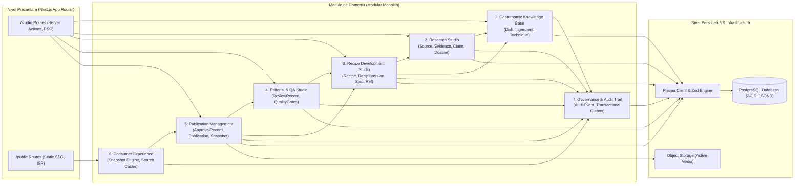

# ATLAS GASTRONOMIC — MODULE ARCHITECTURE

**Document:** Arhitectura Modulelor și Organizarea Monolitului  
**Etapă:** PHASE 2.1 — Architecture Reconciliation  
**Guvernanță:** Atlas AOS  
**Data:** 2026-10-13  
**Statut:** Propunere Arhitecturală Formală  

---

## 1. Diagrama de Arhitectură a Modulelor (Container & Module Architecture)



---

## 2. Cele 7 Module de Domeniu (Responsabilități & Contracte)

### Modulul 1: Gastronomic Knowledge Base (Catalog Canonic)
* **Responsabilitate:** Administrează ontologia gastronomică, clasificările regionale, ingredientele normalizate și echipamentele standard.
* **Entități Deținute:** `Dish`, `Ingredient`, `IngredientAlias`, `Cuisine`, `Region`, `Technique`, `Equipment`.
* **Interfață Publică (Exportată):** `findIngredientById`, `listNormalizedIngredients`, `findDishBySlug`, `searchCanonicalTaxonomy`.
* **Dependențe:** Niciuna (modulul fundamental al ontologiei).
* **Consumatori:** Research Studio, Recipe Development, Consumer Experience.
* **Reguli Bază de Date:** Read/Write doar de către administratori și curatori culinari.

### Modulul 2: Research Studio (Cercetare Epistemologică)
* **Responsabilitate:** Colectarea surselor, extragerea dovezilor textuale verificate, formularea afirmațiilor factuale și elaborarea dosarelor de cercetare.
* **Entități Deținute:** `Source`, `Evidence`, `Claim`, `EvidenceClaim`, `ResearchDossier`, `ResearchDossierVersion`, `DossierClaim`.
* **Interfață Publică:** `createResearchDossier`, `addEvidenceToSource`, `linkClaimToEvidence`, `approveResearchDossier`, `getDossierVersionSnapshot`.
* **Dependențe:** Modulul 1 (Knowledge Base).
* **Consumatori:** Modulul 3 (Recipe Development Studio).
* **Regulă de Blocare:** O rețetă nu poate trece în starea `draft` fără un dosar aprobat emis de acest modul.

### Modulul 3: Recipe Development Studio (Dezvoltare Tehnică Rețete)
* **Responsabilitate:** Redactarea formulelor culinare exacte, normalizarea compoziției ingredientelor, pașii ordonați, timpii, temperaturile și asocierile semantice pas-ingredient.
* **Entități Deținute:** `Recipe`, `RecipeVersion`, `RecipeIngredient`, `RecipeStep`, `StepIngredientRef`.
* **Interfață Publică:** `createRecipeDraft`, `updateRecipeComposition`, `validateRecipeIntegrity`, `submitToTechnicalReview`, `lockRecipeContent`.
* **Dependențe:** Modulul 2 (Research), Modulul 1 (Knowledge Base).
* **Consumatori:** Modulul 4 (Editorial & QA), Modulul 5 (Publication Management).

### Modulul 4: Editorial & QA Studio (Evaluare & Calitate)
* **Responsabilitate:** Evaluarea tehnică culinară și stilistică, aplicarea rubricilor de scoring (Quality Gates), consemnarea obiecțiilor și generarea fișelor formale de review.
* **Entități Deținute:** `ReviewRecord`, `QualityGateResult`, `ReviewRubric`.
* **Interfață Publică:** `evaluateTechnicalGate`, `evaluateEditorialGate`, `getReviewSummaryByVersion`.
* **Dependențe:** Modulul 3 (Recipe Development Studio).
* **Consumatori:** Modulul 5 (Publication Management).

### Modulul 5: Publication Management (Aprobare & Distribuție)
* **Responsabilitate:** Forțarea porții de aprobare umană (`human_approved`), calculul hash-ului de conținut, generarea de `PublicationSnapshot` imuabile, gestionarea publicațiilor pe canale și emiterea evenimentelor de outbox.
* **Entități Deținute:** `ApprovalRecord`, `Publication`, `PublicationSnapshot`.
* **Interfață Publică:** `approveRecipeVersionAction`, `publishToChannelAction`, `withdrawFromChannelAction`, `getActiveSnapshotBySlug`.
* **Dependențe:** Modulul 4 (Editorial & QA), Modulul 3 (Recipe Development Studio).
* **Consumatori:** Modulul 6 (Consumer Experience).

### Modulul 6: Consumer Experience (Portal Public & Livrare)
* **Responsabilitate:** Randarea paginilor statice de rețetă (SSG/ISR), afișarea metadatelor gastronomice, navigarea pe taxonomii și căutarea publică.
* **Entități Deținute:** `SearchIndexCache`, `StaticPageMetadata`.
* **Dependențe:** Modulul 5 (Publication Management).
* **Interdicție Critică de Arhitectură:** **Nu interoghează niciodată tabelele interne din Recipe Development sau Research Studio!** Consumă exclusiv din `PublicationSnapshot`.

### Modulul 7: Governance & Audit Trail (Cross-Cutting)
* **Responsabilitate:** Persistența jurnalului append-only al tuturor evenimentelor de sistem și gestionarea cozii de tranzacții asincrone (Transactional Outbox).
* **Entități Deținute:** `AuditEvent`, `OutboxEvent`.
* **Interfață Publică:** `recordAuditEvent`, `enqueueOutboxEvent`, `claimPendingOutboxEvents`, `markOutboxEventSucceeded`, `failOutboxEvent`.
* **Dependențe:** Niciuna (aspect transversal).
* **Consumatori:** Toate modulele sistemului.

---

## 3. Structura de Directoare Propusă în Aplicație (`src/`)

```text
src/
├── app/
│   ├── (studio)/                       # Rute interne Studio (/studio/*)
│   │   ├── research/
│   │   ├── recipes/
│   │   ├── qa/
│   │   └── admin/
│   └── (public)/                       # Portalul public de consultare
│       ├── [cuisine]/
│       ├── retete/[slug]/
│       └── search/
├── modules/
│   ├── knowledge-base/                 # Modulul 1
│   │   ├── domain/
│   │   ├── services/
│   │   └── index.ts                    # Interfață publică strictă
│   ├── research/                       # Modulul 2
│   ├── recipe-development/             # Modulul 3
│   ├── editorial-qa/                   # Modulul 4
│   ├── publication/                    # Modulul 5
│   ├── consumer/                       # Modulul 6
│   └── audit/                          # Modulul 7
└── shared/
    ├── db/                             # Prisma client & conexiuni
    ├── auth/                           # RBAC & verificare sesiuni
    ├── validation/                     # Validatoare Zod generice
    └── errors/                         # Clase de erori de domeniu
```

---

## 4. Reguli de Dependență și Bariere de Securitate

1. **Fără Dependențe Circulare:** Modulele pot consuma doar module din straturile inferioare sau din același nivel conform fluxului unidirecțional:
   $$\text{CoreKB} \longleftarrow \text{Research} \longleftarrow \text{RecipeDev} \longleftarrow \text{EditorialQA} \longleftarrow \text{PubMgmt} \longleftarrow \text{ConsumerExp}$$
2. **Encapsulare Strictă:** Niciun modul nu accesează tabelele deținute de un alt modul în mod direct prin Prisma; accesul se face exclusiv prin serviciul exportat în `index.ts` al modulului respectiv.
3. **Decuplare Publică:** Modulul `Consumer Experience` primește date doar sub formă de obiecte înghețate `PublicationSnapshot`, protejând integritatea procesului editorial de consultările publice.
