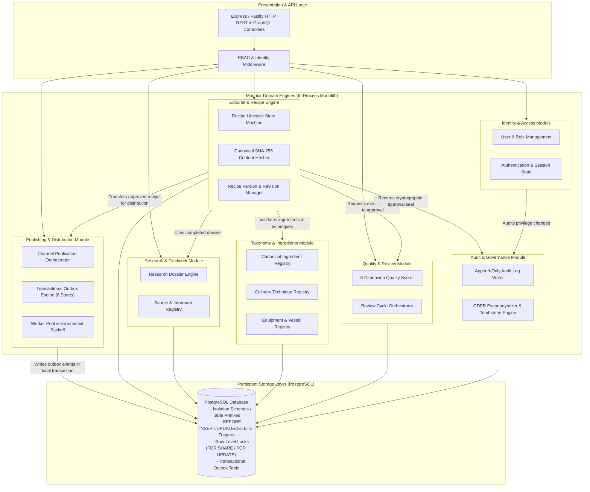
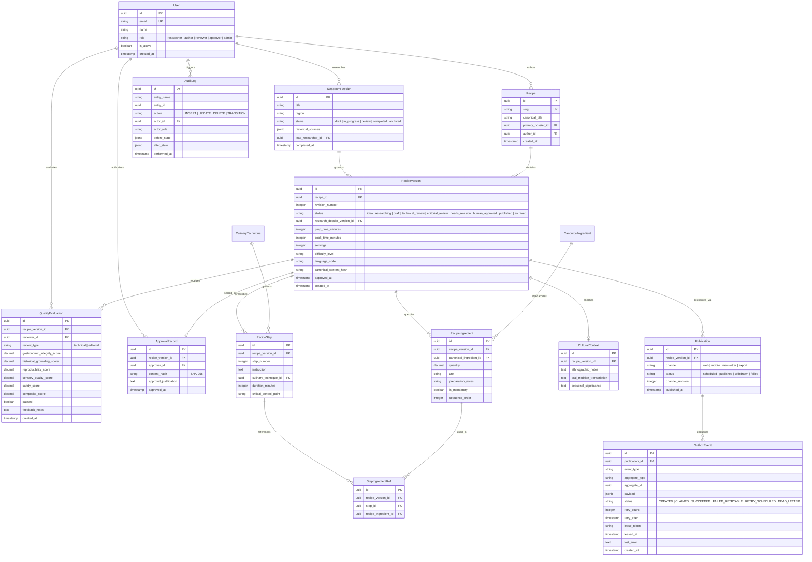
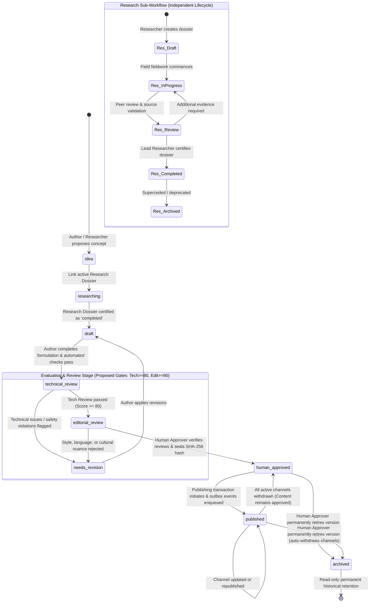
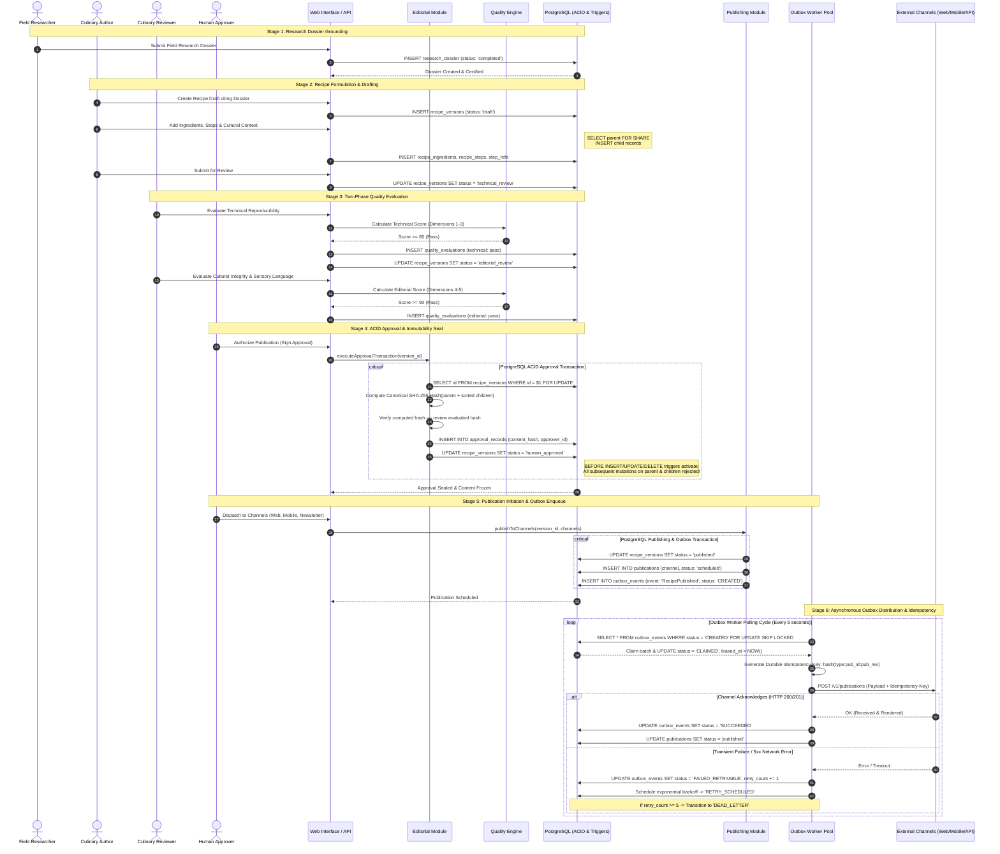

# Atlas Gastronomic — Consolidated Architectural Diagrams & Specifications

**Document:** `ATLAS_PHASE_2_DIAGRAMS.md`  
**Protocol:** Atlas AOS (BOOT → RECONCILE → PLAN → EXECUTE → VERIFY → MEMORY SYNC → HANDOFF)  
**Boundary:** Boundary A Authorized (Documentation Only)  
**Repository:** `https://github.com/hbrnm/atlas-gastronomic`  
**Branch:** `chore/integrate-agent-skills`  
**Baseline Commit:** `1a2f6a3`  
**Standards Pack:** `standards/v1.0.0/` — FROZEN / IMMUTABLE  

---

## 1. Overview

This document serves as the master consolidation of all five core architectural models for **Atlas Gastronomic**:
1. **System Context**
2. **Container & Module Architecture**
3. **Domain Model / Entity-Relationship Model**
4. **Editorial Workflow State Machine**
5. **Research-to-Publication Sequence**

Each model is presented in two dual formats:
- **Mermaid Diagram Code Block** (validated for standard rendering in markdown viewers).
- **Structured Textual Specification** (canonical, unambiguous relational text ensuring complete accessibility and machine readability).

---

## 2. Specification 1: System Context

### 2.1 Mermaid Diagram Code

```mermaid
flowchart TD
    subgraph Actors["Human Actors & Autonomous Agents"]
        Researcher["Field Researcher / Ethnographer"]
        Author["Culinary Author / Chef"]
        Reviewer["Culinary & Technical Reviewer"]
        Approver["Human Approver (Head of Editorial)"]
        Admin["System Administrator (Platform Ops)"]
        AIAgent["AI Research & Quality Agent"]
    end

    subgraph AtlasCore["Atlas Gastronomic Platform (Core System Boundary)"]
        WebUI["Web Editorial Interface (SPA / Next.js)"]
        APIGW["Core API Gateway & App Server (Node.js/TypeScript)"]
        ModularMonolith["Modular Domain Engines (Monolith)"]
        PostgresDB[("PostgreSQL Relational DB (ACID, Triggers, Audit)")]
        OutboxQueue["Transactional Outbox Queue (PostgreSQL Table)"]
        
        WebUI -->|REST / GraphQL / SSE| APIGW
        APIGW --> ModularMonolith
        ModularMonolith -->|Read / Write with ACID Triggers| PostgresDB
        ModularMonolith -->|Transactional Insert| OutboxQueue
    end

    subgraph ExternalSystems["External Systems & Distribution Channels"]
        WebChannel["Public Web & Gastronomic Atlas Portal"]
        MobileApp["Mobile Culinary Guide App (API Consumer)"]
        Newsletter["Newsletter & Syndication Dispatcher"]
        ExportPipeline["Static Archive & Print Export Pipeline"]
        TaxonomyVocab["External Culinary Taxonomy Registries (Agrovoc/Wikidata)"]
        ObjectStore["Immutable Object Storage (Media / Cold Audit)"]
    end

    Researcher -->|Submits ethnographic field dossiers| WebUI
    Author -->|Drafts structured recipes citing dossiers| WebUI
    Reviewer -->|Performs technical & sensory evaluations| WebUI
    Approver -->|Authorizes publication & seals content hash| WebUI
    Admin -->|Manages RBAC, users & system health (NO approval rights)| WebUI
    AIAgent -->|Provides research suggestions & automated rule checks| APIGW

    OutboxQueue -->|Asynchronous Event Worker Dispatch| WebChannel
    OutboxQueue -->|Asynchronous Event Worker Dispatch| MobileApp
    OutboxQueue -->|Asynchronous Event Worker Dispatch| Newsletter
    OutboxQueue -->|Asynchronous Event Worker Dispatch| ExportPipeline
    ModularMonolith <-->|Harmonizes terms & canonical identifiers| TaxonomyVocab
    ModularMonolith -->|Stores raw media & cold audit archives| ObjectStore

    classDef human fill:#e1f5fe,stroke:#0288d1,stroke-width:2px;
    classDef agent fill:#f3e5f5,stroke:#7b1fa2,stroke-width:2px;
    classDef core fill:#fff3e0,stroke:#f57c00,stroke-width:2px;
    classDef external fill:#e8f5e9,stroke:#388e3c,stroke-width:2px;

    class Researcher,Author,Reviewer,Approver,Admin human;
    class AIAgent agent;
    class WebUI,APIGW,ModularMonolith,PostgresDB,OutboxQueue core;
    class WebChannel,MobileApp,Newsletter,ExportPipeline,TaxonomyVocab,ObjectStore external;
```

### 2.2 Structured Textual Specification

- **Core System Boundary:** Atlas Gastronomic Platform provides authoritative gastronomic knowledge management, culinary ethnography tracking, structured recipe formulation, multi-stage human review, immutable content signing, and multi-channel publishing.
- **Human Actors:**
  - *Field Researcher / Ethnographer:* Compiles and submits field observations, cultural context, and oral culinary histories (`ResearchDossier`).
  - *Culinary Author / Chef:* Transcribes culinary knowledge into structured recipe formulations citing completed research dossiers.
  - *Culinary & Technical Reviewer:* Conducts quantitative and qualitative evaluations (technical reproducibility, sensory accuracy, cultural integrity).
  - *Human Approver (Head of Editorial):* Holds sole legal/editorial authority to approve recipes (`human_approved`) and permanently archive them (`archived`). Seals content with cryptographic SHA-256 hash.
  - *System Administrator:* Manages infrastructure, tenant identity, and RBAC permissions. Strictly forbidden from culinary approvals.
- **Autonomous Agents:**
  - *AI Research & Quality Agent:* Analyzes drafts against standard taxonomies, flags missing allergen warnings, computes proposed quality metrics. All agent actions are assistive and advisory (Human-in-the-Loop invariant).
- **External Dependencies & Distribution:**
  - *Taxonomy Registries:* External standards (Agrovoc, Wikidata) for canonical ingredient reconciliation.
  - *Object Storage:* S3/GCS compliant store for high-resolution photography, audio field recordings, and cold audit archives.
  - *Publishing Targets:* Public Website, Mobile App API, Newsletter Dispatcher, and Static Print Pipeline (all fed asynchronously via Transactional Outbox).

---

## 3. Specification 2: Container & Module Architecture

### 3.1 Mermaid Diagram Code



### 3.2 Structured Textual Specification

- **Architecture Style:** In-process **Modular Monolith** in TypeScript/Node.js, backed by a single PostgreSQL database with schema-isolated tables.
- **7 Core Modules & Contracts:**
  1. *Identity & Access Module:* Manages credentials, sessions, roles (`researcher`, `author`, `reviewer`, `approver`, `admin`), and permission checks. Admin cannot approve recipes.
  2. *Research & Fieldwork Module:* Manages `ResearchDossier` and field observations through a 5-state lifecycle (`draft`, `in_progress`, `review`, `completed`, `archived`).
  3. *Editorial & Recipe Engine:* Core domain managing `Recipe` and `RecipeVersion` across 9 canonical statuses. Enforces parent row-level locking during edits and approval, and triggers permanent immutability.
  4. *Taxonomy & Ingredients Module:* Authoritative master data for ingredients, botanical varieties, processing techniques, and regional vessels.
  5. *Quality & Review Module:* Orchestrates technical and editorial reviews across 5 dimensions, emitting evaluations against proposed calibration thresholds (80 technical, 90 editorial).
  6. *Publishing & Distribution Module:* Manages channel-specific `Publication` records and dispatches async events via an exact 6-state Transactional Outbox worker pool with durable consumer idempotency keys.
  7. *Audit & Governance Module:* Immutably captures all domain events and state transitions with JSONB diffs, maintains cryptographic content hashes, and handles GDPR pseudonymization without breaking historical hashes.

---

## 4. Specification 3: Domain Model / Entity-Relationship Model

### 4.1 Mermaid Diagram Code



### 4.2 Structured Textual Specification

- **Relational Integrity Guarantees:**
  - `RecipeVersion` is identified by UUID PK `id` and constrained by unique `(recipe_id, revision_number)`.
  - `StepIngredientRef` enforces hierarchical integrity through composite foreign keys `(recipe_version_id, step_id)` pointing to `recipe_steps` and `(recipe_version_id, recipe_ingredient_id)` pointing to `recipe_ingredients`. This mathematically prevents a step from referencing an ingredient belonging to a different version.
- **Database Immutability Invariant:**
  - Modifying child entities (`RecipeIngredient`, `RecipeStep`, `CulturalContext`, `StepIngredientRef`) locks the parent via `SELECT ... FOR SHARE`.
  - Approving a version locks the parent via `SELECT ... FOR UPDATE`.
  - PostgreSQL `BEFORE INSERT OR UPDATE OR DELETE` triggers unconditionally reject content mutations on `RecipeVersion` and its child tables if parent status $\in$ (`human_approved`, `published`, `archived`).
  - Editorial revisions require creating a new row in `RecipeVersion` with `revision_number = revision_number + 1`.
- **Audit & Cryptographic Invariants:**
  - `ApprovalRecord` seals the exact canonical SHA-256 hash (`v1:sha256:...`) computed deterministically over the version and sorted child records.
  - Audit trail is append-only with proposed 3-year hot retention; user pseudonymization proposals preserve UUIDs and cryptographic hash integrity, subject to formal legal review and Owner approval.

---

## 5. Specification 4: Editorial Workflow State Machine

### 5.1 Mermaid Diagram Code



### 5.2 Structured Textual Specification

- **Canonical Statuses (Standards Pack v1.0.0 — Exactly 9):**
  1. `idea`: Conceptual formulation. Entry: Concept title defined. Exit: Linked to research dossier.
  2. `researching`: Culinary ethnography in progress. Entry: Dossier assigned. Exit: Dossier status is `completed`.
  3. `draft`: Authoring recipe structure, quantities, techniques. Entry: Completed dossier attached. Exit: Formulation complete, automated linting passes.
  4. `technical_review`: Culinary science & reproducibility verification. Entry: Formulation complete. Exit: Technical score $\ge$ 80 (or explicit justification override).
  5. `editorial_review`: Cultural grounding, sensory language, narrative check. Entry: Technical review passed. Exit: Editorial score $\ge$ 90 (or explicit justification override).
  6. `needs_revision`: Feedback remediation loop. Entry: Reviewer rejects formulation. Exit: Author amends content in draft.
  7. `human_approved`: Final culinary certification. Entry: Reviews passed, parent locked `FOR UPDATE`, content hash verified, `ApprovalRecord` signed. **Content FROZEN**.
  8. `published`: Live on one or more external channels. Entry: Publishing transaction commits, outbox event enqueued. **Content FROZEN**.
  9. `archived`: Permanent retirement from active distribution. Entry: Human Approver explicit decision. **Content FROZEN**.
- **Withdrawal vs Archival Semantics:**
  - *Withdrawal:* Operates on `Publication` records per channel. Setting `Publication.status = 'withdrawn'` unpublishes from that specific channel. If 0 channels remain active, `RecipeVersion.status` reverts to `human_approved`.
  - *Archival:* Operates on `RecipeVersion`. Setting `RecipeVersion.status = 'archived'` is a permanent editorial decision that automatically withdraws all active channel publications.
- **Quality Gates:**
  - Composite thresholds of 80 (Technical) and 90 (Editorial) are **PROPOSED operational calibration thresholds**. The Human Approver retains authority to override thresholds if cultural context justifies it, documenting rationale in `ApprovalRecord`.

---

## 6. Specification 5: Research-to-Publication Sequence

### 6.1 Mermaid Diagram Code



### 6.2 Structured Textual Specification

- **Transaction 1: Review & Quality Recording (ACID):**
  - Reviewer inputs quality ratings across the 5 dimensions.
  - Quality Engine computes composite scores.
  - Results saved to `quality_evaluations`; status updated to `editorial_review`.
- **Transaction 2: Human Approval & Cryptographic Sealing (ACID):**
  - Acquires exclusive row lock `SELECT id FROM recipe_versions WHERE id = $1 FOR UPDATE`.
  - Computes deterministic canonical SHA-256 hash (`v1:sha256:...`) over parent fields and sorted child records.
  - Verifies computed hash against the evaluated review hash.
  - Inserts row into `approval_records` with verified `content_hash`.
  - Sets `RecipeVersion.status = 'human_approved'`.
  - Database `BEFORE INSERT OR UPDATE OR DELETE` triggers permanently block subsequent mutations on parent or children.
- **Transaction 3: Publishing Initiation (ACID):**
  - Inserts channel records into `publications`.
  - Sets `RecipeVersion.status = 'published'`.
  - Inserts dispatch records into `outbox_events` with status `CREATED`.
  - Local transaction commits before any external network communication occurs.
- **Asynchronous Distribution (Outbox Worker Pool):**
  - Workers poll `outbox_events` using `FOR UPDATE SKIP LOCKED`, generating a unique `lease_token` per claim and transitioning events to `CLAIMED`.
  - *Lease Duration Policy:* Remains an **open Owner decision** under evaluation between 120s and 300s.
  - *Lease Fencing:* Worker completion verifies `id`, `CLAIMED` status, and matching `lease_token` before updating to `SUCCEEDED`.
  - Dispatches payloads with durable idempotency key: `hash(event_type + ":" + publication_id + ":" + publication_revision)`.
  - Channels record key in `consumer_idempotency_records` to deduplicate incoming requests; downstream side-effects must be naturally idempotent.
  - Successful response sets status to `SUCCEEDED`; transient failures retry up to 5 times before transitioning to `DEAD_LETTER`.
