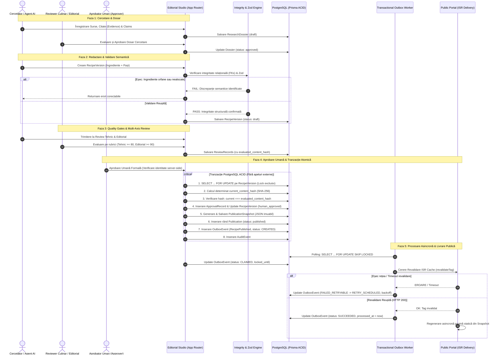

# ATLAS GASTRONOMIC — RESEARCH-TO-PUBLICATION SEQUENCE & RELIABILITY

**Document:** Secvența de Date, Tranzacționalitate, Outbox și Fiabilitate  
**Etapă:** PHASE 2.1 — Architecture Reconciliation  
**Guvernanță:** Atlas AOS  
**Data:** 2026-10-13  
**Statut:** Propunere Arhitecturală Formală  

---

## 1. Diagrama de Secvență (Sequence Diagram)



---

## 2. Granițele Tranzacției ACID vs. Operațiuni Asincrone

Pentru a garanta consistența datelor și a preveni blocajele cauzate de apelurile de rețea externe:

### 2.1 Tranzacția Locală PostgreSQL ACID (Execuție sub 50ms)
Operațiunea de aprobare și publicare execută într-o singură tranzacție atomică:
1. Obținerea lock-ului exclusiv la nivel de rând (`SELECT ... FOR UPDATE`);
2. Calculul deterministic al hash-ului de conținut (`SHA-256`) și verificarea identității sale cu cel evaluat la review;
3. Inserarea `ApprovalRecord` cu semnătura electronică a editorului uman;
4. Marcarea `RecipeVersion.status = 'human_approved'`;
5. Generarea documentului `PublicationSnapshot` (JSON denormalizat);
6. Inserarea înregistrării `Publication` (`channel: 'web_public'`, `status: 'published'`);
7. Inserarea înregistrării `OutboxEvent` (`status = 'CREATED'`);
8. Inserarea evenimentului în `audit_events`.
*Rollback total:* Dacă oricare dintre aceste acțiuni eșuează, baza de date revine intactă la starea anterioară.

### 2.2 Operațiunea Asincronă (Transactional Outbox Worker)
Revalidarea cache-ului public și notificările CDN se execută **strict asincron** în afara tranzacției bazei de date. Aceasta decuplează persistența datelor de disponibilitatea rețelei.

---

## 3. Ciclul de Viață al Transactional Outbox (Exact 6 Stări)

Worker-ul de Outbox operează pe baza a **exact șase stări operaționale**:

```
[ CREATED ] ────────► [ CLAIMED ] ────────► [ SUCCEEDED ] (Stare terminală pozitivă)
                           │
                           ├──► [ FAILED_RETRYABLE ] ──► [ RETRY_SCHEDULED ] ──► (Re-claim)
                           │
                           └──► [ DEAD_LETTER ] (Stare terminală de eșec / Alertă)
```

1. **`CREATED`:** Evenimentul este scris atomic în baza de date cu `retry_count = 0` și o cheie deterministică de idempotență.
2. **`CLAIMED`:** Un nod worker preia evenimentul folosind `SELECT ... FOR UPDATE SKIP LOCKED`, generează un nou `lease_token` (UUID) unic pentru fiecare preluare și aplică un lease temporar până la `locked_until`.
   
   > [!IMPORTANT]
   > **Decizie Deschisă de Calibrare: Durata Lease-ului Worker-ului (120s vs. 300s)**  
   > Durata exactă a lease-ului rămâne o **decizie deschisă a Owner-ului**, urmând a fi calibrată empiric în cadrul spike-ului tehnic din Faza 2.2 sau printr-o decizie explicită a Owner-ului.  
   > *Opțiunea A (120 secunde):* Asigură recuperarea rapidă a evenimentelor orfane după căderea unui nod worker, dar crește riscul de expirare prematură în cazul unor operațiuni lente de rețea.  
   > *Opțiunea B (300 secunde):* Oferă o toleranță superioară pentru apeluri lente de rețea și sarcini batch mari, dar întârzie recuperarea sarcinilor în caz de cădere neașteptată a worker-ului.  
   > Modelul arhitectural de reîncercare și recuperare rămâne pe deplin coerent indiferent de valoarea finală selectată.

3. **`SUCCEEDED`:** Consumatorul extern răspunde cu succes (HTTP 200/201). Worker-ul marchează evenimentul ca finalizat, **sub rezerva verificării stricte de fencing (vezi § 3.1)**.
4. **`FAILED_RETRYABLE`:** Cererea dă eroare tranzitorie (timeout, 502, 503, 504), iar contorul `retry_count < 5`.
5. **`RETRY_SCHEDULED`:** Se calculează următorul timestamp de execuție prin backoff exponențial cu jitter ($5s, 10s, 20s, 40s$). Lease-ul este eliberat, permițând o nouă preluare la scadență.
6. **`DEAD_LETTER` (DLQ):** La atingerea sau depășirea limitei de 5 încercări eșuate sau la erori fatale de client (HTTP 400, 422), evenimentul este transferat în starea terminală `DEAD_LETTER` și se emite o alertă tehnică către echipă. Reluarea se face exclusiv manual după remedierea cauzei.

### 3.1 Fencing-ul de Lease și Protecția Împotriva Workerilor Întârziați (Stale Workers)
Pentru a preveni ca un worker întârziat (stale worker — a cărui execuție a durat peste durata lease-ului) să suprascrie evenimentul după ce acesta a fost deja re-revendicat de un alt nod:
- **Token de Lease Unic:** Fiecare revendicare în starea `CLAIMED` atribuie un nou identificator unic `lease_token`.
- **Garda Tranzacțională la Finalizare:** Operațiunea prin care worker-ul marchează succesul (`SUCCEEDED`) trebuie să verifice simultan:
  - Identificatorul evenimentului (`id`);
  - Statusul curent (`status = 'CLAIMED'`);
  - Potrivirea exactă a token-ului de lease (`lease_token = :current_worker_token`);
  - Valabilitatea temporară a lease-ului (`locked_until > now()`).
- **Comportament la Eșecul Gărzii:** Dacă numărul de rânduri afectate este 0, worker-ul deduce că a pierdut proprietatea asupra evenimentului (lease expirat și preluat de un alt proces) și **trebuie să își abandoneze rezultatul fără a modifica statusul**.

### 3.2 Recuperarea Lease-ului Expirat (Sweeper Loop)
Dacă un worker se oprește neașteptat (crash, OOM, panică de rețea) în starea `CLAIMED`, un proces periodic de curățare (sweeper) scanează evenimentele cu `status = 'CLAIMED' AND locked_until < now()`. Dacă `retry_count < 5`, evenimentul este resetat în `RETRY_SCHEDULED` cu `lease_token` invalidat; altfel, este transferat în `DEAD_LETTER`.

---

## 4. Idempotența Durabilă și Garanțiile la Nivelul Consumatorului

### 4.1 Cheia Deterministică de Idempotență (Fără Timestamp)
Pentru a asigura deduplicarea cererilor dispatchate:

$$\text{idempotency\_key} = \text{SHA-256}(\text{event\_type} + \text{":"} + \text{publication\_id} + \text{":"} + \text{publication\_revision})$$

* Tabela `outbox_events` are constrângere `UNIQUE (idempotency_key)`.
* Inserările duplicate generate de reluări accidentale ale aceleiași comenzi sunt ignorate prin `ON CONFLICT (idempotency_key) DO NOTHING`.

### 4.2 Tabela de Idempotență și Delimitarea Efectelor Secundare Externe
Portalul public și consumatorii de evenimente mențin o tabelă durabilă de deduplicare (`consumer_idempotency_records`).

> [!IMPORTANT]
> **Delimitarea Garanțiilor: Deduplicarea Cererilor vs. Efecte Secundare Exact-Once**  
> Sistemul garantează livrare **at-least-once** (cel puțin o dată).  
> 1. *Deduplicarea Cererilor:* Tabela de idempotență a consumatorului garantează că cererile identice retransmise nu sunt procesate de două ori la nivel de aplicație:
>    - Dacă cheia a fost deja procesată cu **același hash de payload**, consumatorul returnează răspunsul stocat anterior (HTTP 200), evitând execuția redundantă.
>    - Dacă cheia există, dar **payload-ul diferă**, cererea este respinsă imediat cu **`HTTP 409 Conflict`**.
> 2. *Granița Efectelor Secundare Externe:* Înregistrarea durabilă a cheii de idempotență **nu garantează de la sine execuția exact-once a efectelor secundare externe** în caz de crash al nodului consumator. Dacă un consumator cade între executarea unui efect extern (ex: invalidare CDN, trimitere notificare) și salvarea cheii în baza de date, reîncercarea va re-executa efectul. Invers, salvarea cheii înainte de efectul extern riscă pierderea acțiunii la crash.
> 3. *Cerință Arhitecturală de Proiectare:* Pentru a asigura corectitudinea globală a sistemului, toate efectele secundare externe (cum ar fi revalidarea ISR în Next.js sau actualizările de fișiere statice) **trebuie să fie proiectate ca operațiuni natural idempotente** (re-executabile în siguranță de multiple ori fără a altera starea finală).

