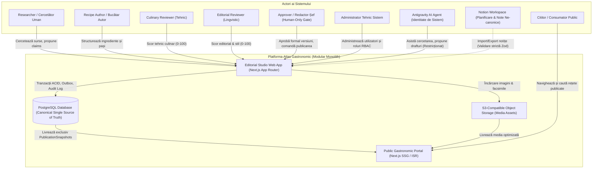

# ATLAS GASTRONOMIC — SYSTEM CONTEXT

**Document:** Contextul de Sistem și Actorii Platformei  
**Etapă:** PHASE 2.1 — Architecture Reconciliation  
**Guvernanță:** Atlas AOS  
**Data:** 2026-10-13  
**Statut:** Propunere Arhitecturală Formală  

---

## 1. Diagrama de Context a Sistemului (System Context Diagram)



---

## 2. Definirea Actorilor și a Responsabilităților

### 2.1 Actori Umani
* **Researcher (Cercetător Gastronomic):**
  - *Responsabilitate:* Identifică și înregistrează sursele bibliografice/web, extrage citatele exacte (`Evidence`), formulează afirmațiile factuale (`Claims`) și elaborează dosarele de cercetare (`ResearchDossier`).
  - *Permisiuni:* Scriere în modulul Research; fără drept de aprobare a dosarelor sau de redactare finală a rețetelor.
* **Recipe Author (Autor Rețetă):**
  - *Responsabilitate:* Elaborează formula culinară (`RecipeVersion`), normalizează ingredientele din catalog (`RecipeIngredient`), structurează pașii procedurali (`RecipeStep`) și stabilește asocierile semantice (`StepIngredientRef`).
  - *Permisiuni:* Scriere în modulul Recipe Development; trimitere către review tehnic.
* **Culinary Reviewer (Evaluator Tehnic):**
  - *Responsabilitate:* Evaluează fezabilitatea gastronomică, proporțiile, timpii, temperaturile și conformitatea de siguranță alimentară. Completează fișa tehnică de evaluare.
  - *Permisiuni:* Scriere în `ReviewRecord` (dimensiunea tehnică).
* **Editorial Reviewer (Evaluator Lingvistic/Stil):**
  - *Responsabilitate:* Verifică acuratețea terminologică, claritatea instrucțiunilor, gramatica și respectarea stilului editorial canonic.
  - *Permisiuni:* Scriere în `ReviewRecord` (dimensiunea editorială).
* **Approver (Redactor-Șef / Autoritate Culinară):**
  - *Responsabilitate:* Evaluează rețetele care au trecut toate recenziile preliminare și aplică semnătura electronică formală de aprobare (`ApprovalRecord`). Deține autoritatea exclusivă de a comanda publicarea (`Publication`).
  - *Permisiuni:* Schimbare status în `human_approved` și `published`. Rol exclusiv uman.
* **Administrator (Administrator Tehnic):**
  - *Responsabilitate:* Mentenanța platformei, configurarea rolurilor utilizatorilor, audit de sistem și monitorizarea workerilor.
  - *Restricție critică de separare a atribuțiilor:* **Nu deține dreptul de aprobare culinară.** Nu poate promova o rețetă în `human_approved`. Poate efectua retragerea tehnică de urgență a unei publicații de pe un canal public.
* **Public Reader (Cititor Public):**
  - *Responsabilitate:* Consultă rețetele, navighează taxonomiile și efectuează căutări pe portalul public.
  - *Permisiuni:* Acces `Read-Only` exclusiv la snapshot-urile publicate active.

### 2.2 Actorul AI (Antigravity AI Agent)
* **Identitate de Sistem:** Autentificat prin token/service account cu `actor_type: AI_AGENT`.
* **Capabilități Permise:** Asistență la cercetare, extragerea pasajelor din texte, propunerea de claims, generarea de drafturi de rețetă, rularea validărilor semantice Zod, sugerarea de corecturi la revizie.
* **Interdicții Absolute de Securitate:**
  1. AI nu poate semna un `ApprovalRecord`.
  2. AI nu poate schimba statusul unei rețete în `human_approved` sau `published`.
  3. AI nu poate emite evenimente de publicare în Outbox.
  4. Orice acțiune a AI-ului este marcată distinct în `audit_events` cu `actor_type = 'AI_AGENT'`.

---

## 3. Integrări Externe și Medii Colaborative

### 3.1 Notion Workspace (Mediu Operațional Intern)
* **Statut:** Instrument extern ne-canonic de productivitate și planificare.
* **Graniță de Date:** Nu se utilizează sincronizare bidirecțională automată în timp real în Faza 1. Datele sunt exportate manual/asincron din Notion și importate în Studio prin parsare și validare strictă Zod. Dacă un import eșuează validarea semantică, este respins.

### 3.2 S3-Compatible Object Storage
* **Rol:** Stochează activele media voluminoase (fotografii pas-cu-pas, imagini finale de preparat, facsimile din cărți vechi, exporturi PDF de arhivă).
* **Securitate:** Încărcările se realizează exclusiv din Studio prin presigned URLs; livrarea publică se face prin CDN cu cache optimizat.

---

## 4. Granițe de Securitate și Zone de Încredere (Trust Boundaries)

```
[ ZONA 1: PUBLIC INTERNET ] 
      │ 
      ▼ (Unauthenticated, Read-Only, CDN/Edge Cache)
[ ZONA 2: PUBLIC GASTRONOMIC PORTAL ]
      │ 
      ▼ (Interogare strictă din PublicationSnapshots, fără acces la tabele de draft)
══════════════════════════════════════════════════════════════════════════════════════
                      GRANIȚĂ CRITICĂ DE SECURITATE (FIREWALL / RBAC)
══════════════════════════════════════════════════════════════════════════════════════
[ ZONA 3: EDITORIAL STUDIO (/studio) ] 
      ▲ (Sesiuni HTTP-only, CSRF protection, RBAC server-side obligatoriu)
      │
[ ZONA 4: CANONICAL CORE & POSTGRESQL ]
      │ (ACID Transactions, Triggere de Imutabilitate, Audit Append-Only)
```

* **Barieră Server-Side:** Nicio decizie de autorizare nu se bazează pe ascunderea elementelor vizuale în interfața de utilizator (UI). Toate Server Actions și rutele API validează rolul utilizatorului și starea entității la nivel de server înainte de a deschide o tranzacție.
