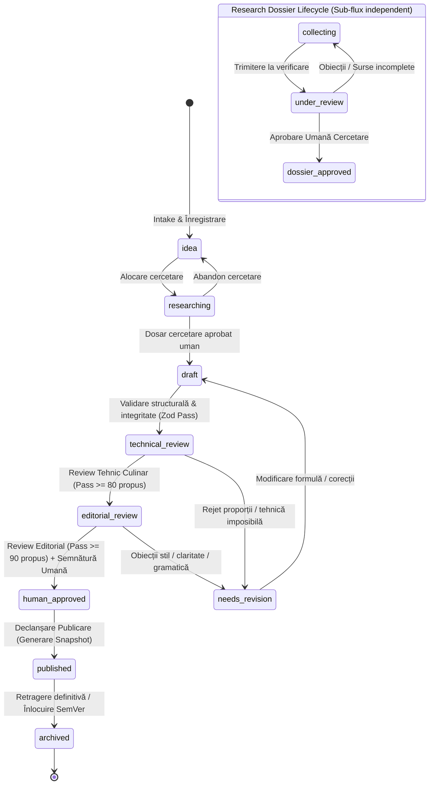

# ATLAS GASTRONOMIC — WORKFLOWS & EDITORIAL LIFECYCLE

**Document:** Ciclul Editorial, Mașina de Stări și Quality Gates  
**Etapă:** PHASE 2.1 — Architecture Reconciliation  
**Guvernanță:** Atlas AOS  
**Data:** 2026-10-13  
**Statut:** Propunere Arhitecturală Formală  

---

## 1. Diagrama Mașinii de Stări a Fluxului Editorial



---

## 2. Tabelul Exhaustiv al Celor 9 Statusuri Canonice (v1.0.0)

Toate cele 9 statusuri din `recipe.schema.json` și `03-workflow.md` sunt păstrate intacte și atribuite entității **`RecipeVersion`**:

| Status Canonic | Dimensiune Guvernanță | Entitate | Condiție de Intrare | Actor Autorizat | Condiție de Ieșire | Conținut Gastronomic |
|---|:---:|:---:|---|---|---|:---:|
| **`idea`** | Editorială | `RecipeVersion` | Intake inițial preparat (nume, arie culinară). | Human / AI | Începerea documentării surselor. | Mutabil |
| **`researching`** | Editorială | `RecipeVersion` | Asignarea unui cercetător responsabil. | Human / AI | **Aprobarea formală a dosarului de cercetare.** | Mutabil |
| **`draft`** | Editorială | `RecipeVersion` | Existența unui dosar aprobat (`dossier_approved`). | Recipe Author / AI | Formula completă + Zod Pass. | Mutabil |
| **`technical_review`**| Editorială | `RecipeVersion` | Structură completă: proporții, timpi, indici. | Recipe Author / AI | Evaluare tehnică culinară completată. | Mutabil |
| **`editorial_review`**| Editorială | `RecipeVersion` | Review Tehnic PASS ($\ge 80$ propus) + zero riscuri. | Culinary Reviewer | Evaluare lingvistică & stil completată. | Mutabil |
| **`needs_revision`** | Editorială | `RecipeVersion` | Rejet cu obiecții la evaluare tehnică/editorială. | Reviewer Culinar/Ed.| Aplicarea corecțiilor și revenirea în `draft`.| Mutabil |
| **`human_approved`** | **Aprobare** | `RecipeVersion` | Review Editorial PASS ($\ge 90$ propus) + Semnătură. | **Approver (Uman Exclusiv)**| Lansarea comenzii de publicare. | **IMUABIL (Înghețat)**|
| **`published`** | **Distribuție**| `RecipeVersion` | $\ge 1$ canal `Publication` activ cu snapshot generat.| **Approver (Uman Exclusiv)**| Retragerea completă de pe toate canalele. | **IMUABIL (Înghețat)**|
| **`archived`** | Distribuție | `RecipeVersion` | Retragere definitivă sau înlocuire cu SemVer nou. | Approver / Admin | Niciuna (Stare de conservare istorică). | **IMUABIL (Înghețat)**|

---

## 3. Ciclul de Viață Separat al Dosarului de Cercetare (`ResearchDossier`)

Pentru a proteja enum-ul canonic al rețetei, dosarul de cercetare deține propriul său ciclu de viață decuplat:
* **`collecting`:** Cercetătorul sau agentul AI adaugă surse bibliografice, extrage citate exacte (`Evidence`) și formulează afirmații (`Claims`).
* **`under_review`:** Dosarul este trimis spre recenzie critică către un cercetător senior sau editor.
* **`approved`:** Un evaluator uman atestă autenticitatea surselor și claritatea dovezilor.
  - *Regulă de Poartă:* **Doar starea `approved` deblochează tranziția rețetei din `researching` în `draft`.**
* **`needs_revision`:** Dosarul prezintă contradicții nerezolvate sau surse necredibile; revine la colectare.
* **Modificarea Ulterioră a Cercetării:** Dacă apar surse noi pentru un preparat deja cercetat, se generează o versiune nouă de dosar (`ResearchDossierVersion v2.0`). Rețetele istorice aprobate rămân neschimbate, conservând referința la dosarul cu care au fost aprobate.

---

## 4. Quality Gates și Rubrica de Evaluare

Evaluarea calității respectă distincția dintre porțile eliminatorii și punctajul agregat:

### 4.1 Criterii Eliminatorii (Hard Blocking Gates)
Următoarele criterii provoacă un **`FAIL` absolut și blochează instantaneu aprobarea**, indiferent dacă punctajul general este de 98/100:
1. **Siguranță Alimentară:** Neverosimilitatea tratamentului termic (ex: temperatură internă insuficientă la carne de pasăre sau pește), lipsa avertismentelor de alergeni majori sau protocoale de răcire incorecte.
2. **Proveniență Falsă sau Plagiat:** Atribuirea falsă a unei origini sau inventarea de surse/autori/citate.
3. **Incompatibilitate Structurală:** Cantități imposibile fizic (proporții eronate) sau omisiunea unei transformări chimice critice.

### 4.2 Scoruri Ponderate pe Rubrici (Calibrare Propusă)
Ponderile orientative conforme `standards/v1.0.0/docs/06-quality-gates.md` sunt definite ca propuneri operaționale:
* *Identitate gastronomică:* 20 puncte
* *Ingrediente și proporții:* 20 puncte
* *Tehnică și execuție:* 20 puncte
* *Cercetare și surse:* 15 puncte
* *Claritate editorială:* 10 puncte
* *Siguranță și alergeni:* 10 puncte
* *Model de date:* 5 puncte
* **Praguri Propuse:** $\ge 80/100$ pentru promovarea la Review Editorial; $\ge 90/100$ pentru candidații la Aprobare Umană.
* **Versionarea Rubricilor:** Fiecare fișă completată stochează `rubric_version` (ex: `v1.0.0`), asigurând auditabilitatea criteriilor în timp.

---

## 5. Semantica Retragerii pe Canal vs. Arhivarea Rețetei

```
                       ┌─────────────────────────────────────────────────────────┐
                       │                     RECIPE VERSION                      │
                       │             (status = human_approved)                   │
                       └────────────────────────────┬────────────────────────────┘
                                                    │
                               ┌────────────────────┴────────────────────┐
                               ▼                                         ▼
                 ┌───────────────────────────┐             ┌───────────────────────────┐
                 │    PUBLICATION (Canal 1)  │             │    PUBLICATION (Canal 2)  │
                 │     (status = active)     │             │     (status = active)     │
                 └─────────────┬─────────────┘             └─────────────┬─────────────┘
                               │                                         │
                 [ Retragere Canal 1 ]                     [ Retragere Canal 2 ]
                               ▼                                         ▼
                 ┌───────────────────────────┐             ┌───────────────────────────┐
                 │    PUBLICATION (Canal 1)  │             │    PUBLICATION (Canal 2)  │
                 │    (status = withdrawn)   │             │    (status = withdrawn)   │
                 └───────────────────────────┘             └───────────────────────────┘
                               │                                         │
                               └────────────────────┬────────────────────┘
                                                    ▼
                               ┌─────────────────────────────────────────┐
                               │ Toate canalele withdrawn:               │
                               │ RecipeVersion revine la: human_approved │
                               └─────────────────────────────────────────┘
```

1. **Retragerea de pe un Canal Individual:** Modifică doar înregistrarea `Publication` respectivă (`status = 'withdrawn'`). Dacă mai există cel puțin un canal activ, `RecipeVersion.status` rămâne `published`.
2. **Retragerea de pe Toate Canalele:** Când ultima publicație devine retrasă, `RecipeVersion.status` revine automat la **`human_approved`**. Aprobarea culinară a versiunii nu este ștearsă sau invalidată; conținutul rămâne read-only, dar nu mai este expus publicului.
3. **Arhivarea Versiunii (`RecipeVersion.status = 'archived'`):** Act formal editorial prin care versiunea este scoasă definitiv din uz (înlocuită de o versiune nouă SemVer sau retrasă din motive editoriale fundamentale).
4. **Separarea Permisiunilor Admin vs Approver:**
   - `Administratorul` poate efectua o **retragere tehnică de urgență pe un canal** (takedown), dar nu poate schimba statusul rețetei în `archived` și nu poate acorda statutul de `human_approved`.
   - `Approver-ul` este singurul actor autorizat să decidă arhivarea editorială a unei rețete.
